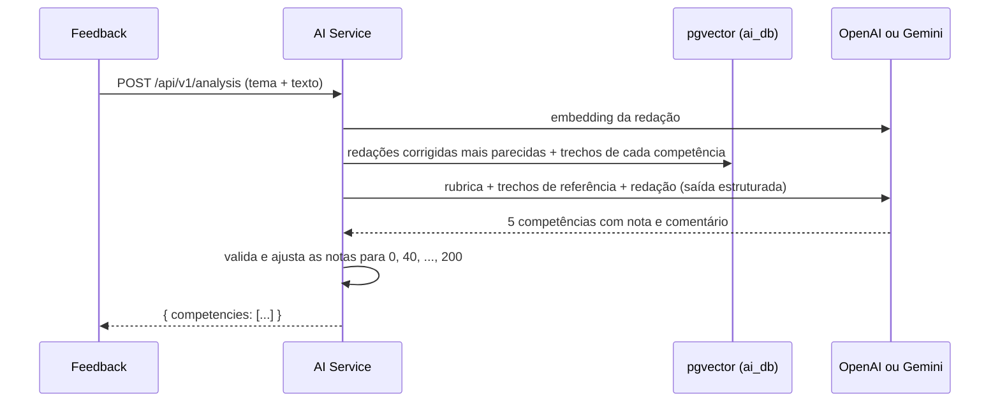

# AI Service

Corrige redações do ENEM com **RAG**: busca no **pgvector** redações reais já corrigidas parecidas com a do aluno (corpus Essay-BR) e trechos de referência por competência, e os envia ao LLM junto com a rubrica, para calibrar as notas das cinco competências.

Stack: FastAPI, LangChain (`langchain-openai`), PostgreSQL com `pgvector` e `psycopg`. Funciona com a **OpenAI** ou com o **Google Gemini** (que tem plano gratuito), escolhidos por `LLM_PROVIDER`.

## Fluxo



## API

`POST /api/v1/analysis`

```json
{ "studentId": "uuid", "essayId": "uuid", "theme": "Tema", "text": "Texto da redação" }
```

| Status | Quando |
|---|---|
| `200` | `{ "competencies": [ { "id": 1, "score": 160, "comment": "..." }, ... ] }`, sempre com as competências 1 a 5 e notas múltiplas de 40. |
| `422` | Campos ausentes ou vazios. |
| `502` | O modelo respondeu, mas sem as cinco competências. |
| `503` | Chave do provedor ausente, ou o modelo não respondeu. |

`GET /health` informa `"analysis": "ready"` ou `"disabled"` (sem chave).

## Base de conhecimento

Fica em [`corpus/`](corpus/README.md): a rubrica (vai inteira no prompt), 1.501 redações reais do Essay-BR com as cinco notas e trechos sintéticos por competência (os dois últimos vetorizados). A ingestão é incremental e roda sozinha quando o serviço sobe; para forçar, use `./mentoria ai-ingest`.

Tabelas em `ai_db`: `corpus_sources` (arquivo e hash) e `corpus_chunks` (texto, competência e nível dos trechos, `scores` das redações e `embedding vector(1536)` com índice HNSW por distância de cosseno).

## Configuração

| Variável | Padrão | Uso |
|---|---|---|
| `LLM_PROVIDER` | `openai` | `openai` ou `gemini`. Define o endpoint e os modelos padrão. |
| `OPENAI_API_KEY` / `GEMINI_API_KEY` / `LLM_API_KEY` | — | Chave do provedor escolhido. Sem ela a análise responde `503`. |
| `LLM_MODEL` | `gpt-4o-mini` / `gemini-3.1-flash-lite` | Modelo de chat. |
| `LLM_BASE_URL` | do provedor | Endpoint compatível com a API da OpenAI (para usar outro provedor). |
| `LLM_TIMEOUT_SECONDS` / `LLM_MAX_RETRIES` | `45` / `1` (`3` no Gemini) | Tempo máximo e novas tentativas da chamada ao modelo. |
| `LLM_STRUCTURED_OUTPUT` | `json_schema` | Como pedir a resposta estruturada (`json_schema`, `function_calling` ou `json_mode`). |
| `EMBEDDING_MODEL` / `EMBEDDING_DIMENSIONS` | `text-embedding-3-small` / `gemini-embedding-001`, `1536` | Embeddings. Vetores maiores (o Gemini gera 3.072) são cortados e renormalizados para 1.536. |
| `EMBEDDING_BATCH` | `200` / `50` | Textos por requisição de embeddings. |
| `RATE_LIMIT_WAIT_SECONDS` | `60` | Espera antes de tentar de novo quando o provedor responde `429`. |
| `RAG_ESSAY_K` | `3` | Redações corrigidas completas no prompt. |
| `RAG_TOP_K` | `3` | Trechos recuperados por competência. |
| `DATABASE_URL`, `PGUSER`, `PGPASSWORD` | — | Conexão com o `ai_db`. |
| `AUTO_INGEST` | `true` | Sincroniza o corpus ao iniciar. |

O Feedback espera a análise por até 60 s, com 2 tentativas (`AI_TIMEOUT` e `AI_ATTEMPTS` no Feedback).

## Usando o Gemini (gratuito)

1. Crie uma chave em [Google AI Studio](https://aistudio.google.com) → *Get API key*.
2. Em `infrastructure/docker/.env`: `LLM_PROVIDER=gemini` e `GEMINI_API_KEY=<sua chave>`.
3. `./mentoria start` (ou `./mentoria restart ai-service`) e depois `./mentoria ai-analyze`.

Pontos de atenção:

- **Primeira vetorização lenta:** o plano gratuito limita tokens por minuto, então vetorizar as 1.501 redações pode levar dezenas de minutos. A ingestão grava cada lote e, ao receber `429`, espera e continua; se o limite diário acabar, a próxima subida retoma de onde parou. Acompanhe com `./mentoria logs ai-service`. Para testar mais rápido, use uma base menor: `./mentoria ai-import --corpus-size 300`.
- **Avaliação:** `./mentoria ai-eval` espera 6 s entre chamadas no Gemini para respeitar o limite por minuto.
- **Privacidade:** no plano gratuito, o Google pode usar o conteúdo enviado para melhorar seus produtos. Serve para testar com a base pública Essay-BR; para redações reais de alunos, use um plano pago.
- **Trocar de provedor** faz a base ser vetorizada de novo automaticamente, porque embeddings de modelos diferentes não são comparáveis.

Os limites de cada modelo aparecem no AI Studio. O Google desativa modelos antigos para contas novas (o `gemini-2.5-flash`, por exemplo, responde `404`) e os modelos "flash" mais novos às vezes respondem `503` por alta demanda. Se a análise falhar, a mensagem de erro do provedor aparece no campo `detail` da resposta; troque `LLM_MODEL` por outro modelo listado no AI Studio se necessário.

## Testes

```bash
./mentoria ai-test
```

Os testes usam LLM, embeddings e banco simulados. O teste do pgvector real roda quando `TEST_DATABASE_URL` aponta para um banco com a extensão `vector`.

Com a stack no ar e a chave configurada, `./mentoria ai-analyze` envia uma redação de exemplo e mostra a correção.

## Avaliação

`./mentoria ai-eval 20` corrige 20 redações do conjunto de avaliação (`eval/essay-br-test.jsonl`, que não está no RAG) **com e sem RAG** e compara com as notas humanas:

- erro médio por competência e na nota total;
- percentual de notas iguais às humanas e com diferença de até 40 pontos.

Cada redação gera uma chamada ao LLM por modo (com 20 redações, são 40 chamadas).
