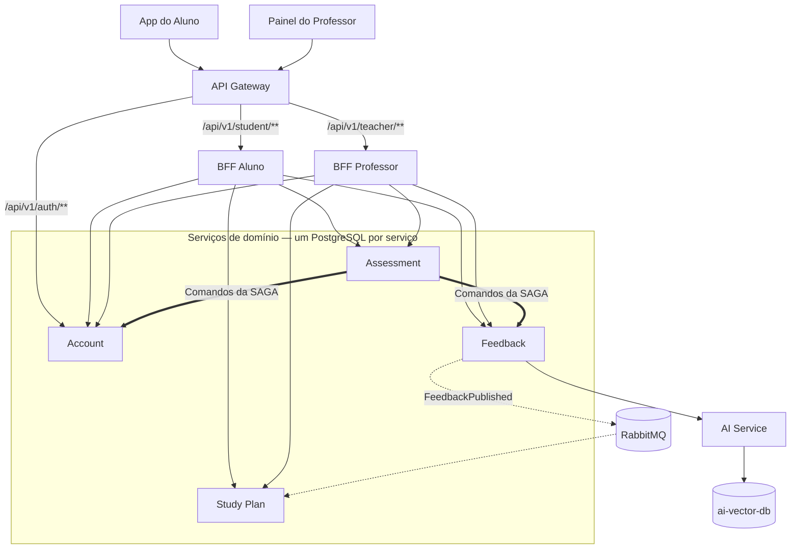

# Visão Geral da Arquitetura — MentorIA

## 1. Decisão arquitetural

A MentorIA utilizará uma arquitetura de microsserviços, composta por quatro serviços de domínio independentes: **Account, Assessment, Feedback e Study Plan**.

Cada serviço será desenvolvido em Java com Spring Boot e terá sua própria instância PostgreSQL. A comunicação externa será centralizada em um API Gateway, com dois BFFs para atender às necessidades de alunos e professores.

## 2. Escopo do MVP

O MVP da MentorIA será focado na preparação e correção de redações, permitindo:

- Autenticação de alunos e professores.
- Escolha de temas e envio de redações.
- Solicitação de correção com inteligência artificial.
- Feedback baseado nas cinco competências do ENEM.
- Geração de tarefas de reforço a partir das dificuldades identificadas.
- Acompanhamento do progresso dos alunos.
- Visualização do desempenho da turma pelo professor.

Funcionalidades como simulados e questões objetivas poderão ser incorporadas futuramente ao Assessment, sem alterar a arquitetura definida.

## 3. Arquitetura geral

Os quatro serviços de domínio possuem bancos PostgreSQL independentes. Nenhum serviço acessa diretamente o banco de outro.

## 4. Componentes da arquitetura

| Componente | Responsabilidade |
|---|---|
| App do Aluno | Aplicação web para o estudante, utilizada principalmente no celular. |
| Painel do Professor | Aplicação web para acompanhamento de turmas e estudantes, utilizada no desktop. |
| API Gateway | Autenticação, autorização e roteamento de requisições. |
| BFF Aluno | Organiza as informações necessárias à aplicação do aluno. |
| BFF Professor | Agrega dados para acompanhamento dos estudantes e turmas. |
| Account | Gerencia usuários, turmas e cotas de correção. |
| Assessment | Gerencia redações, solicitações de correção e a SAGA. |
| Feedback | Processa, armazena e publica os feedbacks. |
| Study Plan | Gerencia planos de estudo, tarefas e progresso. |
| AI Service | Componente de apoio responsável pela análise de redações com IA e RAG. Não integra os quatro serviços de domínio. |
| RabbitMQ | Transporta eventos entre Feedback e Study Plan. |

## 5. Comunicação entre os componentes

A arquitetura utiliza duas formas principais de comunicação.

### Comunicação síncrona — REST

As aplicações acessam o sistema pelo API Gateway, que encaminha as requisições ao BFF correspondente.

Os BFFs consultam os serviços de domínio por meio de APIs REST.

Na solicitação de correção, o Assessment também utiliza chamadas REST para coordenar a SAGA com Account e Feedback.

### Comunicação assíncrona — Eventos

Após a publicação de um feedback, o Feedback registra o evento `FeedbackPublished` utilizando o padrão Outbox.

O evento é publicado no RabbitMQ e consumido pelo Study Plan, que atualiza as tarefas e informações de progresso do estudante.

Essa comunicação permite que o plano de estudos seja atualizado de forma eventual, sem fazer parte da transação da SAGA.

## 6. Justificativa da arquitetura

A separação em microsserviços permite organizar as responsabilidades do sistema em domínios independentes, com bancos de dados próprios e comunicação por interfaces definidas.

A alternativa de um único backend foi descartada porque a lentidão ou indisponibilidade do processamento com IA poderia comprometer outras funcionalidades da aplicação. Além disso, a separação permite escalar o Feedback de forma independente, sem aumentar desnecessariamente os recursos dos demais serviços.

Cada serviço também possui dados e regras de negócio que evoluem por motivos diferentes, favorecendo a separação de responsabilidades.

O API Gateway centraliza as responsabilidades comuns de acesso, enquanto os BFFs adaptam as respostas às necessidades específicas de alunos e professores.
