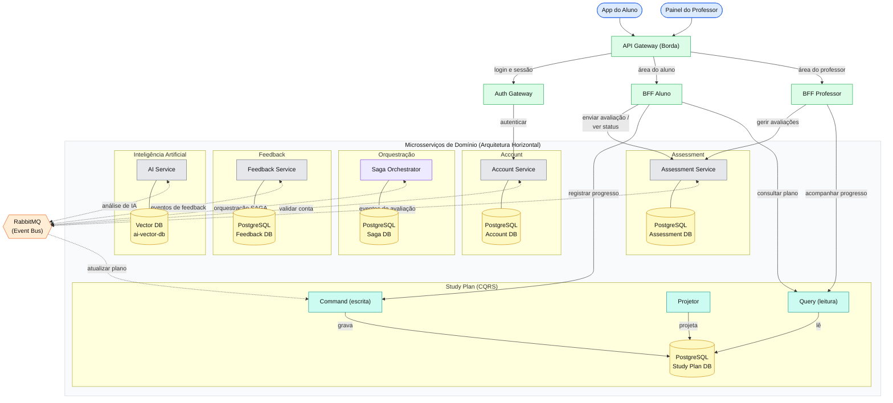

## Visão Geral da Arquitetura — MentorIA

### 1. Decisão arquitetural

A MentorIA utilizará uma arquitetura de microsserviços orientada a eventos, composta por **quatro serviços de domínio independentes** (`Account`, `Assessment`, `Feedback` e `Study Plan`), apoiados por um **serviço dedicado de orquestração (`Saga Orchestrator`)** e um **serviço de apoio de Inteligência Artificial (`AI Service`)**.

Cada serviço será desenvolvido em Java com Spring Boot e possuirá seu próprio banco de dados isolado (instâncias PostgreSQL independentes e um Vector DB para a IA). A camada de entrada será centralizada em um **API Gateway de borda**, que roteia as requisições para o **Auth Gateway** (fluxos de login e sessão) e para **dois BFFs** (`BFF Aluno` e `BFF Professor`), adaptando os contratos às necessidades de cada cliente.

### 2. Escopo do MVP

O MVP da MentorIA será focado na preparação e correção de redações, permitindo:

- Autenticação de alunos e professores.
- Escolha de temas e envio de redações.
- Solicitação de correção com inteligência artificial.
- Feedback baseado nas cinco competências do ENEM.
- Geração de tarefas de reforço a partir das dificuldades identificadas.
- Acompanhamento do progresso dos alunos.
- Visualização do desempenho da turma pelo professor.

Funcionalidades como simulados e questões objetivas poderão ser incorporadas futuramente ao `Assessment`, sem alterar a arquitetura definida.

### 3. Arquitetura geral

Todos os microsserviços operam em nível horizontal, sem hierarquia entre si, e seguem o padrão _Database per Service_: cada serviço possui seu próprio banco de dados e nenhum serviço acessa diretamente o banco de outro. Para garantir consistência entre o banco local e a mensageria, os serviços utilizam o padrão **Transactional Outbox** e controle de idempotência (`processed_events`). Além disso, o `Study Plan` adota o padrão **CQRS**, separando os modelos de escrita (`plan_write`) e leitura (`plan_read`).

Ver código Mermaid do diagrama

### 4. Componentes da arquitetura

| Componente                    | Responsabilidade                                                                                                                              |
| :---------------------------- | :-------------------------------------------------------------------------------------------------------------------------------------------- |
| **App do Aluno**              | Aplicação web para o estudante, utilizada principalmente no celular.                                                                          |
| **Painel do Professor**       | Aplicação web para acompanhamento de turmas e estudantes, utilizada no desktop.                                                               |
| **API Gateway (Borda)**       | Ponto único de entrada externa, responsável pelo roteamento de borda para os gateways/BFFs.                                                   |
| **Auth Gateway**              | Gerencia os fluxos de autenticação e sessão junto ao `Account`, evitando acesso direto aos serviços de domínio.                               |
| **BFF Aluno**                 | Agrega e adapta as informações necessárias à aplicação do aluno.                                                                              |
| **BFF Professor**             | Agrega e adapta dados para acompanhamento dos estudantes e turmas.                                                                            |
| **Account Service**           | Gerencia usuários, turmas e cotas de correção (com `Account DB`).                                                                             |
| **Assessment Service**        | Gerencia redações e solicitações de correção, iniciando o fluxo distribuído (com `Assessment DB`).                                            |
| **Saga Orchestrator**         | Serviço dedicado que orquestra a transação distribuída da correção de redações e suas eventuais compensações (com `Saga DB`).                 |
| **Feedback Service**          | Processa, armazena e publica os feedbacks das redações (com `Feedback DB`).                                                                   |
| **Study Plan Service (CQRS)** | Gerencia planos de estudo, tarefas e progresso, separando operações de escrita (`Command`) e consulta otimizada (`Query`) no `Study Plan DB`. |
| **AI Service**                | Componente de apoio responsável pela análise de redações com IA e RAG, utilizando base vetorial (`ai-vector-db`).                             |
| **RabbitMQ (Event Bus)**      | Barramento central de mensageria que transporta eventos de domínio e comandos/respostas assíncronas entre os serviços.                        |

### 5. Comunicação entre os componentes

A arquitetura utiliza dois contratos bem definidos de comunicação:

- **Comunicação síncrona — Contratos REST / JSON:** As aplicações clientes acessam o sistema pelo `API Gateway`, que direciona o tráfego de autenticação para o `Auth Gateway` e as operações de negócio para o `BFF Aluno` ou `BFF Professor`. Os BFFs se comunicam com os serviços de domínio via APIs REST síncronas para consultas imediatas e registro de comandos.
- **Comunicação assíncrona — Contratos Orientados a Eventos (RabbitMQ):** Toda a coordenação entre microsserviços ocorre de forma assíncrona pelo barramento `RabbitMQ`. Ao receber uma redação, o `Assessment` publica o evento `IniciarSaga`, consumido pelo `Saga Orchestrator`. O orquestrador coordena as etapas de validação de conta (`Account`), geração de feedback (`Feedback`) e análise pedagógica (`AI Service`) via comandos e eventos de resposta. Ao finalizar a correção, o `Feedback` publica o evento `FeedbackPublished` (via Outbox), consumido pelo lado de escrita (`Command`) do `Study Plan`, que atualiza o plano e projeta os dados para consulta (`Query`) com consistência eventual.

#### Contratos Síncronos (REST / JSON)

| Origem                        | Destino                                        | Ação de Negócio                                        | Padrão              |
| :---------------------------- | :--------------------------------------------- | :----------------------------------------------------- | :------------------ |
| `API Gateway`                 | `Auth Gateway` / `BFF Aluno` / `BFF Professor` | Roteamento de borda por perfil de acesso               | REST / JSON         |
| `Auth Gateway`                | `Account Service`                              | Autenticação, emissão e validação de sessão            | REST / JSON         |
| `BFF Aluno`                   | `Assessment Service`                           | Submissão de avaliação e consulta de status            | REST / JSON         |
| `BFF Professor`               | `Assessment Service`                           | Criação, edição e gestão de avaliações                 | REST / JSON         |
| `BFF Aluno`                   | `Study Plan (Command)`                         | Registro de conclusão e progresso de estudo            | REST / JSON (Write) |
| `BFF Aluno` / `BFF Professor` | `Study Plan (Query)`                           | Consulta ao plano de estudos consolidado (`plan_read`) | REST / JSON (Read)  |

#### Contratos Assíncronos (RabbitMQ — Event Bus)

| Grupo no Diagrama        | Evento / Comando                       | Produtor             | Consumidor                         | Papel no Fluxo                                                     |
| :----------------------- | :------------------------------------- | :------------------- | :--------------------------------- | :----------------------------------------------------------------- |
| **eventos de avaliação** | `IniciarSaga`                          | `Assessment Service` | `Saga Orchestrator`                | Dispara o fluxo distribuído após submissão da avaliação            |
| **eventos de avaliação** | `SagaConcluida` / `SagaFalhou`         | `Saga Orchestrator`  | `Assessment Service`               | Atualiza o status final da avaliação (concluída ou compensada)     |
| **orquestração SAGA**    | `ValidarConta` / `GerarFeedback`       | `Saga Orchestrator`  | `Account` / `Feedback`             | Comandos orquestrados para avançar ou compensar etapas             |
| **validar conta**        | `ValidarConta`                         | `Saga Orchestrator`  | `Account Service`                  | Solicita verificação de elegibilidade da conta do aluno            |
| **validar conta**        | `ContaValidada` / `ContaRejeitada`     | `Account Service`    | `Saga Orchestrator`                | Resposta da validação para prosseguir ou abortar a SAGA            |
| **eventos de feedback**  | `FeedbackGerado` / `FeedbackPublished` | `Feedback Service`   | `Saga Orchestrator` / `Study Plan` | Confirma geração do feedback e notifica atualização de plano       |
| **análise de IA**        | `PedidoAnaliseIA`                      | `Feedback Service`   | `AI Service`                       | Solicita diagnóstico pedagógico usando base vetorial (`Vector DB`) |
| **análise de IA**        | `ResultadoIA`                          | `AI Service`         | `Feedback Service`                 | Retorna a análise gerada para composição do feedback final         |
| **atualizar plano**      | `FeedbackPublished`                    | `Feedback Service`   | `Study Plan (Command)`             | Dispara recálculo do plano de estudos na base `plan_write`         |

### 6. Justificativa da arquitetura

A separação em microsserviços permite organizar as responsabilidades do sistema em domínios independentes, com bancos de dados próprios e comunicação por interfaces bem definidas.

A alternativa de um único backend foi descartada porque a lentidão ou indisponibilidade do processamento com IA poderia comprometer outras funcionalidades da aplicação. Além disso, a separação permite escalar o `Feedback` e o `AI Service` de forma independente, sem aumentar desnecessariamente os recursos dos demais serviços.

O isolamento do `Saga Orchestrator` evita acoplar regras de orquestração transacional dentro do domínio de avaliações (`Assessment`), enquanto a adoção de **CQRS** no `Study Plan` garante consultas rápidas aos painéis de acompanhamento de alunos e professores sem impactar as operações de escrita. Por fim, o `API Gateway` e o `Auth Gateway` centralizam o controle de borda, enquanto os BFFs adaptam as respostas às necessidades específicas de cada perfil de usuário.
