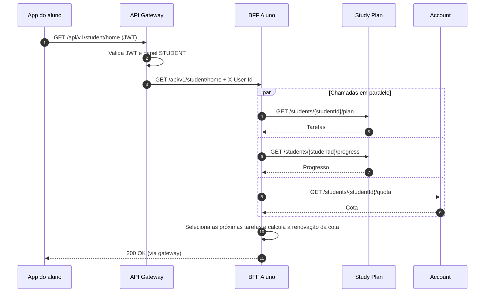

# Backend for Frontend (BFF)

## 1. Decisão

A MentorIA terá dois BFFs, um por cliente: o **BFF Aluno** (`bff-student`), para o app do aluno usado no celular, e o **BFF Professor** (`bff-teacher`), para o painel do professor usado no desktop. Cada BFF agrega os serviços de domínio e devolve as respostas no formato que a tela do seu cliente precisa.

---

## 2. Como funciona

### 2.1 Posição na arquitetura

| Componente | Responsabilidade |
|---|---|
| **Gateway** | Valida o JWT, autoriza por papel, limita requisições, aplica CORS e gera o `X-Correlation-Id`. |
| **BFF** | Agrega os serviços, adapta o formato à tela, garante que o usuário só veja os próprios dados e reescreve os links HATEOAS. |
| **Serviços de domínio** | Regras de negócio e persistência. |

Os BFFs são feitos em Spring Boot e não têm banco próprio: são *stateless*. Eles recebem o `X-User-Id` do gateway e o usam para identificar o usuário. O ID do aluno nunca vem do cliente.

Os comandos da SAGA (`PUT` e `DELETE` de reserva e de feedback) não são expostos por nenhum BFF.

### 2.2 BFF Aluno

Todas as rotas começam com `/api/v1/student` e exigem papel `STUDENT`.

| Verbo | Rota | Serviços chamados | Descrição |
|---|---|---|---|
| `GET` | `/home` | Study Plan, Account | Tela inicial: cota, próximas tarefas e progresso. |
| `POST` | `/essays/{essayId}/correction-requests` | Assessment | Pede a correção (`202`). |
| `GET` | `/correction-requests/{requestId}` | Assessment | Estado da correção, com os links reescritos. |
| `GET` | `/themes` | Assessment | Temas disponíveis. |
| `POST` | `/essays` | Assessment | Envia uma redação. |
| `GET` | `/essays` | Assessment | Redações do aluno. |
| `GET` | `/essays/{essayId}` | Assessment | Detalhe de uma redação. |
| `GET` | `/feedbacks/{requestId}` | Feedback | Feedback publicado de uma correção. |
| `GET` | `/plan` | Study Plan | Plano de estudos e tarefas. |
| `PATCH` | `/tasks/{taskId}` | Study Plan | Marca uma tarefa como concluída. |
| `GET` | `/quota` | Account | Situação da cota no mês. |

As duas primeiras são as rotas principais. As demais completam as telas do app e são o destino dos links HATEOAS (`04-api-rest.md`, seção 2.4).

Antes de devolver uma redação, um feedback ou de alterar uma tarefa, o BFF confere se o recurso pertence ao aluno do `X-User-Id`. Se não pertencer, responde `404`, sem revelar que o recurso existe.

### 2.3 BFF Professor

Todas as rotas começam com `/api/v1/teacher` e exigem papel `TEACHER`.

| Verbo | Rota | Serviços chamados | Descrição |
|---|---|---|---|
| `GET` | `/classes/{classId}/overview` | Account, Study Plan | Resumo da turma e alunos que precisam de apoio. |
| `GET` | `/students/{studentId}` | Study Plan, Assessment, Feedback | Visão completa de um aluno: progresso, redações e feedbacks. |
| `GET` | `/classes` | Account | Turmas do professor. |

Antes de responder, o BFF consulta o Account (`GET /classes?teacherId=`) para verificar se a turma, ou a turma do aluno, pertence ao professor. Se não pertencer, responde `403`.

### 2.4 Mesmos dados, respostas diferentes

As duas telas principais partem dos mesmos dados: o progresso por competência que o Study Plan guarda no modelo de leitura. Cada BFF entrega esses dados em um formato diferente.

**BFF Aluno — `GET /api/v1/student/home`:**

```json
{
  "quota": { "available": 3, "renewsOn": "2026-11-01" },
  "nextTasks": [
    { "id": "t-18", "title": "Proposta de intervenção: 2 exercícios",
      "competency": 5, "done": false }
  ],
  "progress": { "lastScore": 640, "trend": "up" },
  "_links": { "newEssay": { "href": "/api/v1/student/essays" } }
}
```

**BFF Professor — `GET /api/v1/teacher/classes/3A/overview`:**

```json
{
  "classId": "3A",
  "students": 32,
  "averageScore": 588,
  "weakestCompetency": 5,
  "needSupport": [
    { "studentId": "a3c9", "name": "Aluno exemplo", "lastScore": 420,
      "trend": "down", "pendingTasks": 6 }
  ]
}
```

| Aspecto | BFF Aluno | BFF Professor |
|---|---|---|
| **De quem são os dados** | Só do próprio aluno. | Da turma inteira (32 alunos no exemplo). |
| **Pergunta que a tela responde** | "O que eu faço agora?" | "Quem da turma precisa de apoio?" |
| **Progresso** | Última nota e tendência do aluno. | Média da turma, competência mais fraca e alunos ordenados por necessidade. |
| **Conteúdo extra** | Cota disponível e próximas tarefas. | Nome e tarefas pendentes de cada aluno que precisa de apoio. |
| **Navegação** | Link para a próxima ação (`newEssay`). | Sem ações: o painel é de consulta. |
| **Chamadas internas** | 3: plano e progresso no Study Plan, cota no Account. | 2: alunos da turma no Account e progresso de todos em uma única chamada (`GET /progress?studentIds=`) no Study Plan. |
| **Tamanho** | Pequeno, cabe em uma tela de celular. | Maior, para uma tela de desktop. |

### 2.5 Agregação da tela inicial



As chamadas são feitas em paralelo, cada uma com *timeout* de 2 s. Se o Account não responder, a tela inicial ainda é entregue com `"quota": null`, já que a cota é verificada de qualquer forma na SAGA. Se o Study Plan não responder, o BFF responde `503`, pois tarefas e progresso são o conteúdo principal da tela.

---

## 3. Por que essa escolha

**Por que dois BFFs.** O aluno usa o celular, vê só os próprios dados e quer a próxima ação em uma chamada pequena. O professor usa o desktop, vê muitos alunos de uma vez e quer saber quem precisa de apoio. São telas que fazem perguntas diferentes sobre os mesmos dados.

**Alternativas descartadas:**

| Alternativa | Motivo do descarte |
|---|---|
| **Um único BFF para os dois clientes** | Teria de servir ao celular respostas grandes ou obrigar o painel a várias chamadas por tela. Regras de permissão de aluno e de professor ficariam misturadas, e uma mudança em uma tela afetaria a outra. |
| **Clientes chamando os serviços diretamente** | Exporia os serviços internos e os comandos da SAGA. O celular faria três chamadas para montar a tela inicial, aumentando a latência em rede móvel. |
| **Agregação no gateway** | O gateway passaria a conhecer o formato das telas. Ele fica restrito ao que vale para todo o tráfego externo: autenticação, autorização, rate limit e CORS. |
