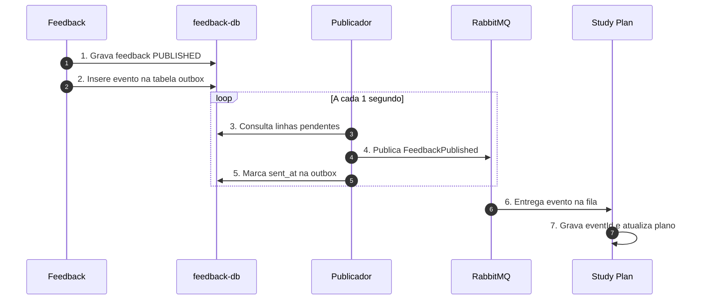

# Banco de Dados, Consistência Eventual e Padrão Outbox

## 1. Decisão arquitetural

A MentorIA adotará o padrão **Database per Service**, utilizando quatro instâncias separadas de PostgreSQL (`account-db`, `assessment-db`, `feedback-db` e `study-plan-db`), cada uma com seu próprio volume de armazenamento.Tecnologia justificada: A escolha do PostgreSQL se dá pela necessidade absoluta de suporte a transações ACID, recurso indispensável para que as operações de negócio e as tabelas de mensageria (outbox e domain_event) sejam gravadas simultaneamente de forma atômica.

Para garantir a integração assíncrona entre o `Feedback` e o `Study Plan` sem risco de perda de dados ou inconsistência (*dual write*), será utilizado o **Padrão Outbox** no serviço `Feedback`.

---

## 2. Análise de Risco de Dual Write por Serviço

Feedback: Possui risco crítico de dual write ao salvar a nota no banco e despachar o evento para a mensageria. Risco eliminado usando a tabela outbox na mesma transação local.

Study Plan: Risco ao consumir do broker e atualizar a base. Mitigado através da idempotência no consumo, utilizando a tabela processed_events.

Assessment: Risco análogo de falha no meio da orquestração síncrona. Contornado com a persistência atômica do estado de cada etapa (saga_states).

Account: Não há risco de dual write, pois as reservas e consumos de cotas ocorrem exclusivamente dentro de transações transacionais no próprio banco.

---

## 3. Como funciona Independência dos Bancos e Tabelas Principais

### Independência dos Bancos e Tabelas Principais

Nenhum serviço acessa diretamente o banco de dados de outro. Identificadores externos (como `studentId` e `essayId`) são armazenados apenas como referência em texto.

| Serviço | Banco | Tabelas Principais | Propósito Transacional |
| :--- | :--- | :--- | :--- |
| **Account** | `account-db` | `users`, `classes`, `quotas`, `quota_reservations` | Controle atômico e reserva de cota. |
| **Assessment** | `assessment-db` | `themes`, `essays`, `correction_requests`, `saga_states` | Registro do envio e estado da SAGA. |
| **Feedback** | `feedback-db` | `feedbacks`, `competency_scores`, `outbox` | Gravação do feedback e evento na mesma transação. |
| **Study Plan** | `study-plan-db` | `plan`, `task`, `processed_events`, `domain_event` | Escrita do plano e deduplicação de eventos. |

### Janelas de Consistência Eventual

| Onde ocorre | Estado visível | Janela aceita |
| :--- | :--- | :--- |
| **Solicitação de correção** | Status `PROCESSING` enquanto a SAGA roda | Até 60 s (tempo do LLM) |
| **Cota de correções** | Unidade em estado `RESERVED` antes de consumida | Durante a execução da SAGA |
| **Notificação de plano** | Feedback `PUBLISHED` antes da nova tarefa surgir | Poucos segundos |
| **Progresso do aluno** | Tarefa em `DONE` antes da atualização do indicador | Até 2 s |

### Funcionamento do Padrão Outbox

1. Na transação local de publicação do feedback (Passo 4 da SAGA), o `Feedback` altera o estado para `PUBLISHED` e insere o evento na tabela `outbox`.

