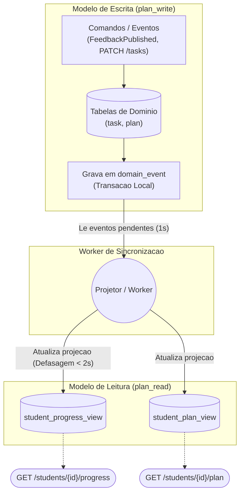

# CQRS no Serviço Study Plan

## 1. Decisão arquitetural

O `study-plan-service` utilizará o padrão **CQRS (Command Query Responsibility Segregation)**, separando a estrutura de escrita da estrutura de leitura em dois *schemas* independentes (`plan_write` e `plan_read`) dentro da mesma instância do PostgreSQL.

A sincronização entre a escrita e a leitura ocorre de forma assíncrona, operando sob consistência eventual com uma defasagem máxima aceita de 2 segundos.

---

## 2. Como funciona

### Divisão dos Modelos (Escrita vs. Leitura)

| Característica | Modelo de Escrita (`plan_write`) | Modelo de Leitura (`plan_read`) |
| :--- | :--- | :--- |
| **Tabelas** | `plan`, `task`, `competency_score`, `domain_event`, `processed_events` | `student_plan_view`, `student_progress_view` |
| **Estrutura** | Normalizada (uma linha por tarefa e nota) | Desnormalizada (dados consolidados por aluno) |
| **Operações** | Processa comandos (`FeedbackPublished` e `PATCH /tasks/{taskId}`) | Atualizado exclusivamente pelo **projetor** |
| **Acesso** | Utilizado apenas na lógica interna de escrita | Atende aos endpoints `GET` de planos e progresso |

### Fluxo de Atualização da Projeção

1. Toda operação de escrita grava os dados nas tabelas transacionais e insere um registro na tabela `domain_event` (`TasksRecommended`, `TaskCompleted` ou `ScoreRecorded`) na mesma transação local.
2. Um projetor (*worker* assíncrono) lê os eventos pendentes a cada 1 segundo em ordem cronológica.
3. O projetor consolida os dados e reescreve a linha do aluno nas visões desnormalizadas (`student_plan_view` e `student_progress_view`).

