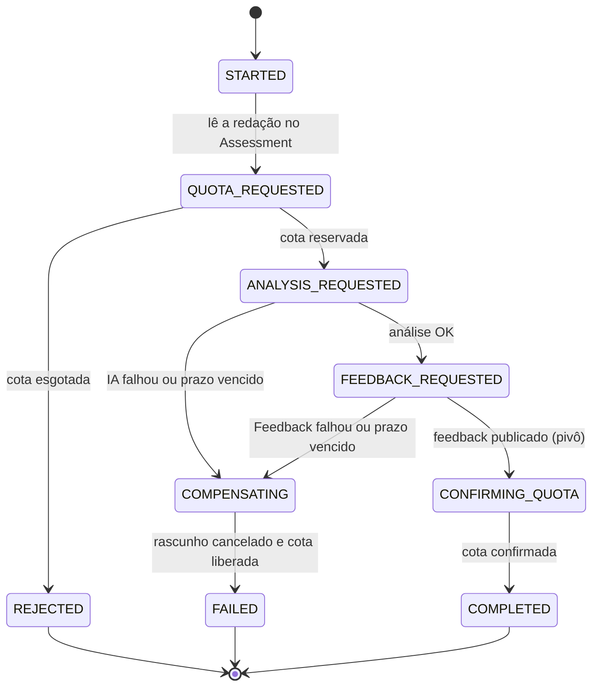
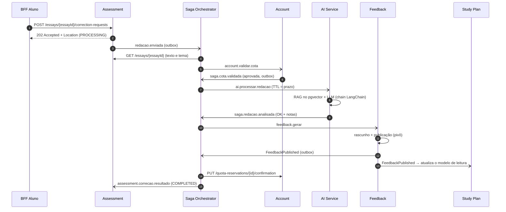
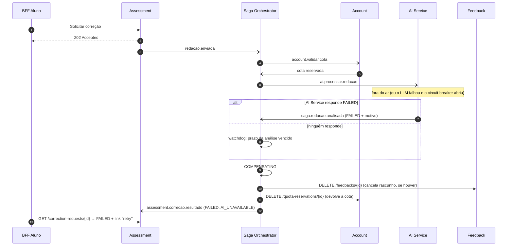

# SAGA — Solicitação de Correção de Redação

## Objetivo

A SAGA coordena a correção de uma redação, que atravessa quatro serviços com bancos próprios. Ela garante que, ao final, ou tudo foi feito (feedback publicado, cota consumida, solicitação concluída) ou tudo foi desfeito por compensações (rascunho cancelado, cota devolvida, solicitação marcada como falha).

## Estratégia escolhida: SAGA orquestrada

A SAGA é **orquestrada** por um serviço dedicado, o **Saga Orchestrator** (`services/saga-orchestrator`), com banco próprio (`postgres-saga`) onde ficam o estado de cada SAGA e o histórico de passos.

Por que orquestrada e não coreografada:

- O fluxo tem ordem rígida (cota → análise → feedback → confirmação). Numa coreografia, cada serviço precisaria reagir a eventos dos outros e conhecer as compensações alheias, e a sequência ficaria espalhada pelos quatro serviços.
- O orquestrador concentra o estado em um lugar só. Isso permite consultar em que passo cada correção está (`GET /api/v1/sagas/{requestId}`) e aplicar prazos: se o AI Service não responde, é o orquestrador que decide compensar.
- Os participantes ficam simples: cada um só executa comandos idempotentes (reservar, analisar, publicar, cancelar, liberar) sem saber da SAGA.

## Participantes

| Serviço | Papel na SAGA | Comunicação |
|---|---|---|
| **Assessment** | Cria a solicitação `PROCESSING`, publica `redacao.enviada` pela outbox e recebe o resultado final. | RabbitMQ (outbox) |
| **Account** | Reserva a cota (compensação: libera) e, no fim, confirma o consumo. | RabbitMQ (reserva, via outbox) e REST (liberar/confirmar) |
| **AI Service** | Corrige a redação com RAG e responde `OK` com as notas ou `FAILED` com o motivo. | RabbitMQ |
| **Feedback** | Grava o rascunho e publica o feedback (ponto pivô). Compensação: cancela o rascunho. | RabbitMQ (gerar) e REST (cancelar) |

O **Study Plan** fica fora da SAGA: ele consome `FeedbackPublished` para atualizar o modelo de leitura do CQRS.

## Estados



## Passos e compensações

| Passo | Serviço | Ação | Compensação |
|---|---|---|---|
| 1 | Assessment | Cria a solicitação `PROCESSING` e grava `redacao.enviada` na outbox. | Recebe `FAILED`/`REJECTED` e libera a redação para nova tentativa. |
| 2 | Account | Reserva 1 correção da cota mensal (`account.validar.cota`). | `DELETE /api/v1/quota-reservations/{id}` devolve a reserva. |
| 3 | AI Service | Corrige com RAG (`ai.processar.redacao`) e responde em `saga.redacao.analisada`. | Nada a desfazer (não grava estado de negócio). |
| 4 | Feedback | Grava o rascunho e publica o feedback (`feedback.gerar`); `FeedbackPublished` sai pela outbox. | `DELETE /api/v1/feedbacks/{id}` cancela o rascunho. |
| 5 | Account | Confirma o consumo (`PUT /api/v1/quota-reservations/{id}/confirmation`). | — (depois do pivô a SAGA só avança; falhas técnicas são repetidas). |
| 6 | Assessment | Marca a solicitação como `COMPLETED`. | — |

A **publicação do feedback é o ponto pivô**. Antes dela, qualquer falha leva à compensação. Depois dela, a SAGA só avança: se o Account estiver fora do ar na confirmação, o orquestrador repete o passo até conseguir. Se uma compensação encontrar o feedback já publicado (resposta `409` do Feedback), ela é interrompida e a SAGA segue em frente.

Toda reserva já conta contra a cota disponível, então um atraso na confirmação não permite passar do limite.

## Prazos, idempotência e mensagens atrasadas

- **Prazo da análise** (`SAGA_ANALYSIS_TIMEOUT`, padrão 60 s) e **do feedback** (30 s): um watchdog no orquestrador verifica a cada 5 s as SAGAs com prazo vencido e inicia a compensação. Os comandos vão com o mesmo tempo de vida (TTL) no RabbitMQ, então um comando que ninguém consumiu expira em vez de ser processado depois da compensação.
- **Respostas atrasadas** (ex.: a IA responde depois do prazo) são ignoradas: cada transição é um compare-and-set no banco (`UPDATE ... WHERE status = ?`) e o passo `RESPOSTA_TARDIA_IGNORADA` fica registrado.
- **Idempotência**: a SAGA é identificada pelo `requestId` do Assessment (um `requestId`, uma SAGA). Reserva, confirmação, liberação, rascunho, publicação e cancelamento são idempotentes por `requestId`, então reenvios e retentativas não duplicam efeitos.
- **Retentativas**: se o Account não responder à reserva em 10 s, o comando é reenviado. Compensações e confirmações que falharem por erro técnico são repetidas automaticamente.

## Caminho feliz



## Falha com compensação: AI Service indisponível



Se a falha acontece no Feedback (ex.: banco fora do ar), ele responde em `saga.feedback.falhou` e a compensação é a mesma, com motivo `PUBLICATION_ERROR`.

## Como demonstrar

Com a stack no ar (`./mentoria start`):

```bash
./mentoria saga          # caminho feliz, pelo gateway e pelo BFF do aluno
./mentoria saga-falha    # derruba o AI Service, pede a correção e mostra a compensação
./mentoria sagas         # últimas SAGAs do orquestrador
curl http://localhost:8090/api/v1/sagas/<requestId>   # estado e passos de uma SAGA
```

Os dois primeiros comandos mostram o estado final no Assessment, os passos registrados pelo orquestrador e a cota antes e depois: no caminho feliz a cota é consumida; na falha ela volta ao valor anterior. Para a falha ficar mais rápida na apresentação, use `SAGA_ANALYSIS_TIMEOUT=20s` no `infrastructure/docker/.env`.

O caminho feliz exige a chave do provedor de IA. Sem a chave, o AI Service responde `FAILED` e toda correção termina compensada, o que também demonstra a SAGA, mas não o feedback.
